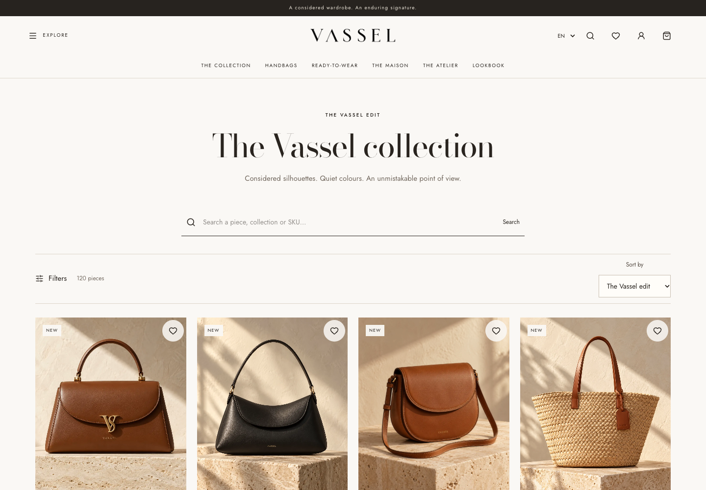
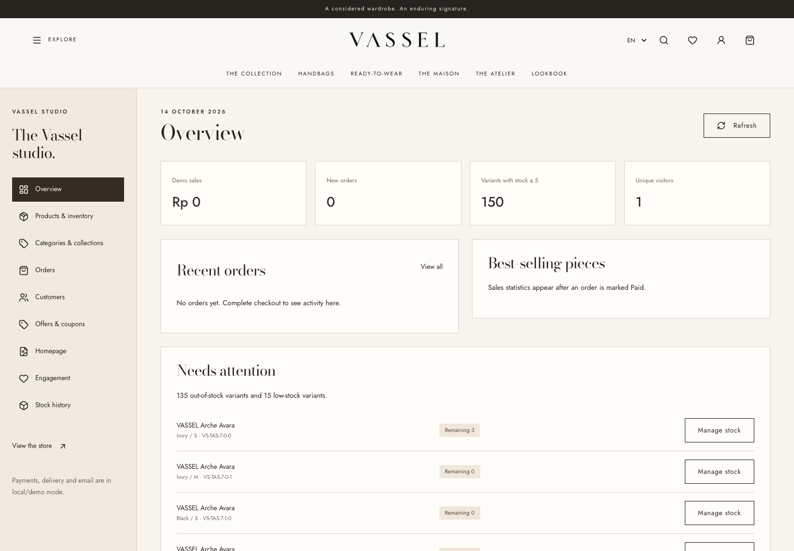

# VASSEL

Website e-commerce fashion dengan desain editorial premium, pilihan **English / Français**, dan harga Rupiah. Dibangun menggunakan React, TypeScript, Vite, Express, dan SQLite.

## Preview


| Katalog | Admin dashboard |
| --- | --- |
|  |  |

<details>
<summary>Tampilan mobile</summary>


</details>

## Fitur

- **Storefront:** hero foto statis, animasi halus, Maison, Atelier, Lookbook, dan tampilan responsif.
- **Katalog:** 125 produk contoh, varian warna/ukuran, stok, pencarian, filter, sorting, galeri, dan wishlist.
- **Pembeli:** daftar/login, profil, alamat, keranjang, checkout, kupon, riwayat dan status pesanan.
- **Admin:** produk/foto/stok, kategori/koleksi, pesanan/resi, pelanggan, promo, konten EN/FR, ulasan dan statistik.
- **Sinkronisasi:** perubahan admin tampil di storefront; stok berkurang saat checkout dan kembali saat pesanan dibatalkan.

## Menjalankan

Gunakan **Node.js 22.16+**.

```bash
npm ci
npm run dev
```

Buka **http://localhost:3002**. Database dan akun demo dibuat otomatis. Konfigurasi tersedia di `.env.example`.

```bash
npm run build
npm start
```

Aplikasi memerlukan server Node untuk menjalankan API. Database dan upload lokal berada di `data/`, yang tidak disertakan dalam repository.

## Akun demo

| Role | Login | Email | Password |
| --- | --- | --- | --- |
| Admin | `/admin/login` | `admin@vassel.test` | `VasselAdmin!2026` |
| Pembeli | `/login` | `pembeli@vassel.test` | `VasselBelanja!2026` |

Admin mengelola toko; pembeli berbelanja dan melihat pesanan. Akun demo hanya untuk pengujian lokal. Untuk deployment, gunakan database baru, `DEMO_MODE=false`, dan buat admin melalui `npm run create:admin` dengan variabel `ADMIN_EMAIL`, `ADMIN_NAME`, dan `ADMIN_PASSWORD`.

## Pengujian

```bash
npm run typecheck
npm test
npm run test:api
npm run test:browser
```

Tes browser membutuhkan Google Chrome dan menggunakan database sementara.

## Status integrasi

Pembayaran transfer/QRIS, tarif kurir, dan email masih demo. Sebelum menerima transaksi nyata, hubungkan layanan terkait, isi kontak/kebijakan toko, dan validasi foto serta spesifikasi produk.

Detail implementasi: [audit](docs/AUDIT.md) · [aset](docs/ASSETS.md).
